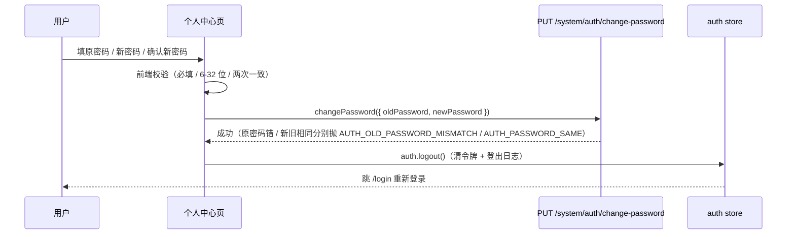

# 个人中心设计（基本信息展示 + 修改密码）

> 状态：已定稿（2026-10-22）。本文是个人中心页面与修改密码链路的唯一设计依据——路由入口、页面结构、改密交互与后端接口约定均以本文为准。

## 1. 背景与目标

底座此前**没有任何修改密码途径**：管理侧重置密码只恢复初始口令，且旧版「内置管理员一刀切保护」连 admin 的重置也拒绝——种子口令 `admin123` 上线后无法修复，是真实安全隐患。同时登录页 footer 明文展示「种子账号：admin / admin123」，公开发布即泄露。

本设计一并解决：

1. **修改密码**：任何登录用户（含 admin）在个人中心自助改密（验旧设新）
2. **种子口令撤出登录页**：面向开发者的种子账号说明只保留在 README / CLAUDE.md，不出现在用户可见 UI

配套的后端保护策略调整（admin 不再一刀切禁改，改为「最后一名启用超管」动态保护）见[权限设计 §2.2](../指南/权限设计.md)。

## 2. 路由与入口

| 项 | 约定 |
| --- | --- |
| 路由 | `router/modules/profile.ts`，挂主布局子路由：path `profile`、name `Profile`（PascalCase，keep-alive 契约；不参与缓存） |
| meta | `{ title: '个人中心', hidden: true }`——不进侧栏菜单，直链 `/profile` 可达（`hidden` 既有约定，菜单过滤零改动） |
| 权限 | 不挂 `meta.permission`：仅需登录（改密是自助操作，与角色无关） |
| 入口 | 顶栏用户下拉（`DefaultUserDropdown`）新增「个人中心」菜单项，置于「退出登录」上方 |

## 3. 页面结构（`web/src/views/profile/index.vue`）

白卡片视觉（`--n1-*` token），纵向两张卡：

1. **基本信息卡**：登录账号 / 用户昵称 / 角色标签（`el-tag`）。数据直接消费 auth store 已拉取的 permission-info（`user.username` / `user.nickname` / `roles`），不发新请求
2. **修改密码卡**：`el-form` 三字段——原密码 / 新密码 / 确认新密码（`type="password"` + `show-password`）。前端校验：必填、新密码 6–32 位、两次输入一致；提交调 `changePasswordApi`

改密成功流程：`ElMessage.success('密码已修改，请重新登录')` → `auth.logout()`（清令牌 + 埋登出日志）→ 跳 `/login` 强制重新认证。

## 4. 后端接口约定

`PUT /system/auth/change-password`（`AuthController`，仅认证——不挂 `@RequirePermissions`，与 logout / get-permission-info 同级；挂 `@OperateLog('个人中心', '修改密码')`，password 字段由操作日志拦截器掩敏）：

| 字段 | 约束 |
| --- | --- |
| `oldPassword` | 必填，≤ 32 位 |
| `newPassword` | 必填，6–32 位（`UserCreateDto.password` 同步补最小 6 位约束，避免初始口令弱于改密标准） |

服务端（`AuthService.changePassword`）：查用户 → `bcrypt.compareSync` 验原密码（不匹配抛 `AUTH_OLD_PASSWORD_MISMATCH` 100000002「原密码不正确」）→ 新旧相同抛 `AUTH_PASSWORD_SAME` 100000003 → BCrypt（cost 10，常量收敛至 `system.constants.ts`）散列后保存。

## 5. 安全说明

- **会话失效**：无状态 JWT（ADR-003）逐请求只校验用户存在与启用，不含密码版本——改密后其他设备的存量 token 至多存续 8h（签发有效期）。当前设备由前端强制重登立即失效。如需「改密即全端踢出」，需引入密码版本号进 token 载荷，属后续演进，本期不做
- **种子口令治理**：登录页不再展示种子账号信息；部署后第一步应登录 admin 完成改密（README 部署清单注明）
