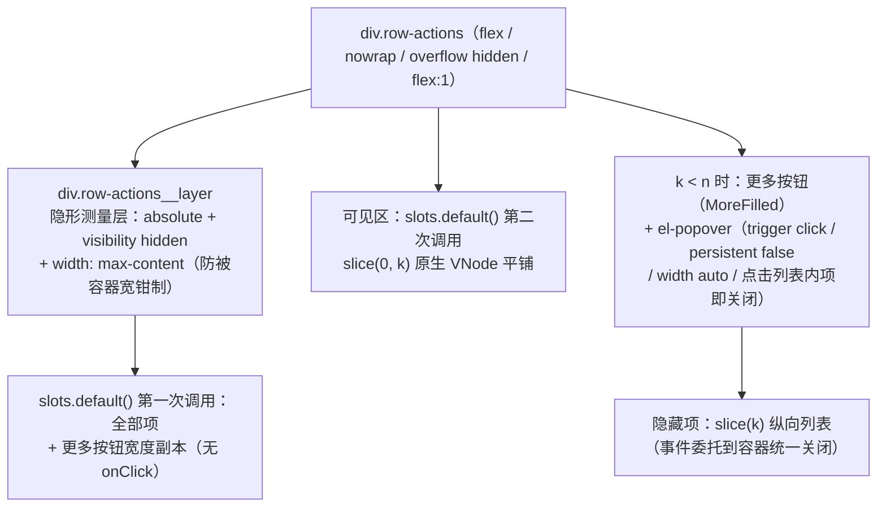

# 前端表格组件设计（N1Table，基于 vxe-table）

> 状态：已定稿（2026-09-29）。本文是 web 前端表格层的唯一设计依据——组件封装、列宽 / 列序调整、按路由持久化、主题映射与页面迁移约定均以本文为准。

## 1. 背景与目标

系统管理与业务模块的列表页原先直接使用 Element Plus 的 `el-table`（10 个页面，每页裸写样板），存在两类问题：

1. **能力缺口**：el-table 不支持列宽拖拽调整与列顺序拖拽调整，宽表（日志页、用户页）在窄屏下的可读性只能靠写死 `min-width` 兜底
2. **样板重复**：分页状态、表格骨架、字典渲染等在每页复制粘贴，无封装层

目标：

- 列表表格统一替换为 **vxe-table**（[x-extends/vxe-table](https://github.com/x-extends/vxe-table)，v4），封装为业务组件 **`N1Table`**
- 所有表格**默认支持**列宽拖拽调整与列顺序拖拽调整，页面零配置
- 用户调整结果（列宽 + 列序）**按页面路由为 key 持久化到 localStorage**，刷新 / 重进自动恢复

## 2. 选型与引入

### 2.1 依赖

| 包 | 版本 | 用途 |
| --- | --- | --- |
| `vxe-table` | ^4.22 | 表格组件本体（Vue 3 对应 v4） |
| `vxe-pc-ui` | ^4.18 | vxe-table v4 的伴随 UI 库（组件与类型定义实际出处） |
| `xe-utils` | ^4 | vxe 系基础工具库 |

与 Element Plus **共存分工**：EP 继续承担表单 / 弹窗 / 消息 / 分页器等，表格场景一律 `N1Table`（vxe-table）。分页器维持 `el-pagination` 不变。

### 2.2 注册方式（`web/src/main.ts`）

与 EP 一致采用**全量注册**：

```ts
import VxeUIAll from 'vxe-pc-ui'
import 'vxe-pc-ui/lib/style.css'
import VxeUITable from 'vxe-table'
import 'vxe-table/lib/style.css'

app.use(VxeUIAll).use(VxeUITable)
```

样式覆盖 `styles/vxe-overrides.css` 经 `styles/index.css` 在 vxe 样式**之后**引入，保证变量映射生效。vxe 默认 locale 即中文（zh-CN），无需配置。

## 3. N1Table 封装（`web/src/components/N1Table/`）

### 3.1 设计思路

薄封装：`vxe-table` + `v-for` 渲染 `vxe-column`，做三件事——**声明式列配置、单元格插槽桥接、列状态持久化**。其余（树形配置、行配置等）经 `$attrs` 透传。

```text
web/src/components/N1Table/
├── index.vue            # 组件本体
├── column-persist.ts    # 列状态持久化纯函数（单测守护对象）
├── types.ts             # N1TableColumn 列定义类型
└── index.spec.ts        # column-persist 单元测试
```

### 3.2 组件接口

```ts
props: {
  columns: N1TableColumn[]   // 必填：列定义（见 3.3）
  data: unknown[]            // 必填：行数据
  loading?: boolean          // vxe 自带 loading 遮罩
  persistKey?: string        // 持久化视图 key，默认取当前路由 name（见 §4.2）
}
// 其余属性透传 vxe-table（tree-config / row-config / stripe / height / border …），
// 页面透传值优先于组件默认值；class / 事件监听同样落表格根元素
```

组件内置默认值（页面可通过 attrs 覆盖）：

| 默认 | 值 | 说明 |
| --- | --- | --- |
| `column-config` | `{ useKey: true, resizable: true, drag: true }` | **列宽 + 列序拖拽默认开启**（本组件存在的核心理由） |
| `column-drag-config` | `{ showIcon: true }` | 列拖拽交互为**表头把手**模式：vxe 须 `showIcon` 渲染 `.vxe-cell--drag-handle` 把手，把手 mousedown 激活 `th.draggable` 后原生拖动方可启动（默认关闭即拖拽不可用，故组件强制开启）。把手**hover 表头时浮现于标题左侧的留白空隙**（vxe 默认常显于标题前，交互覆写见 §5） |
| `cell-config` | `{ padding: true }` | vxe 4.22 默认单元格 padding 为 **0**（内容贴边），显式开启四边留白；实际数值由 §5 的 padding 变量与竖直覆写控制（左右 16px / 竖直 10px） |
| `row-config` | `{ useKey: true, isHover: true }` | 行 hover 高亮 |
| `stripe` | `true` | 斑马纹，与原 el-table 页面一致 |
| `show-overflow` | `'tooltip'` | 溢出省略 + 悬浮提示（表格视觉整齐优先） |

### 3.3 列定义类型（`types.ts`）

```ts
interface N1TableColumn<Row = any> {
  field: string            // 必填且页面内唯一：列标识，同时是持久化 key
  title?: string
  width?: number | string
  minWidth?: number | string
  fixed?: 'left' | 'right'
  align?: 'left' | 'center' | 'right'
  showOverflow?: boolean | 'tooltip' | 'ellipsis' | 'title'
  formatter?: (params: { cellValue: any; row: Row }) => string | number
  slot?: string            // 自定义单元格：指向 N1Table 具名插槽
  // 其余 vxe-column 属性原样透传
}
```

约定：

- **列必须有 `field`**（含纯操作列，统一 `field: 'action'`）——持久化与拖拽 key 的前提
- 时间列用 `formatter: dateTimeFormatter`（`utils/format.ts`，vxe 签名 `{ cellValue } → string`；原 el 签名的 `dateTimeColumnFormatter` 随迁移删除）
- 自定义单元格（DictTag / 操作按钮）经 `slot` 指名，模板写在 N1Table 标签内，参数解构 `{ row }` 与原 el-table 习惯一致

### 3.4 页面使用范式（以岗位管理为例）

```vue
<N1Table :columns="columns" :data="tableData" :loading="loading">
  <template #status="{ row }">
    <DictTag type="common_status" :value="row.status" />
  </template>
  <template #action="{ row }">
    <el-button v-hasPermi="'system:post:update'" link type="primary" @click="openUpdate(row)">编辑</el-button>
    <el-button v-hasPermi="'system:post:delete'" link type="danger" @click="handleDelete(row)">删除</el-button>
  </template>
</N1Table>
```

```ts
const columns: N1TableColumn<PostVO>[] = [
  { field: 'code', title: '岗位编码', minWidth: 120 },
  { field: 'name', title: '岗位名称', minWidth: 140 },
  { field: 'sort', title: '排序', width: 80 },
  { field: 'status', title: '状态', width: 80, slot: 'status' },
  { field: 'createTime', title: '创建时间', minWidth: 170, formatter: dateTimeFormatter },
  { field: 'action', title: '操作', width: 140, fixed: 'right', slot: 'action' },
]
```

树形表格（部门管理）：`:tree-config="{ children: 'children', expandAll: true }"` + `:row-config="{ keyField: 'id' }"` 经 attrs 透传，行为与原 `row-key` / `tree-props` / `default-expand-all` 等价。

## 4. 列宽与列序的按路由持久化

### 4.1 存储结构（localStorage，经 `utils/storage.ts` 读写）

- 总 key：**`N1_TABLE_COLS`**（对齐 `N1_TOKEN` / `N1_APP` / `N1_TAGS` 命名惯例）
- 值：`{ [viewKey]: TableColumnState }` 的字典：

```ts
interface TableColumnState {
  order: string[]                 // 列顺序（field 数组，左 → 右）
  widths: Record<string, number>  // 用户拖拽过的列宽（field → 像素，四舍五入整数）
}
```

### 4.2 视图 key（viewKey）

| 场景 | viewKey | 说明 |
| --- | --- | --- |
| 页面级表格（默认） | 路由 `name`（PascalCase，如 `SystemUser`） | **以路由为 key**；同一页面不同 query 参数共享列状态（query 不参与 key，避免碎片化）；路由 name 与 keep-alive 缓存键同源，天然唯一 |
| 非页面级表格（抽屉 / 弹窗内） | 显式传 `persistKey`，格式 `路由name:子标识` | 如字典数据抽屉 `persistKey="SystemDict:data"` |

### 4.3 保存与恢复算法

**保存**（组件内监听 vxe 事件，页面零感知）：

- 触发时机：`column-resizable-change`（列宽拖拽结束）/ `column-dragend`（列序拖拽结束）
- 数据来源：事件仅作信号，状态统一从表格实例 `getColumns()` 读取（field、`resizeWidth`、当前顺序），不依赖事件参数形态，对 vxe 小版本升级稳健
- 读取时机：延迟到下一宏任务（`setTimeout 0`）——`column-dragend` 触发时 vxe 内部列序**尚未重排**（页面上已变化），同步读取会落盘拖拽前的旧顺序
- 写入规则：`order` 为全部有 field 列的当前顺序；`widths` **以既有记录为基底合并**本次 `resizeWidth`——纯拖列序（无 `resizeWidth`）不冲掉历史列宽，本次拖出的新宽度覆盖旧值，已删除列的历史宽度随重建清理；无 field 列跳过

**恢复**（组件渲染列前应用 `applyColumnState`）：

1. `order` 重排：以存储顺序为主；存储中已不存在于代码列定义的字段（列被删）直接忽略；代码新增列（存储中没有）按原定义相对顺序**追加尾部**
2. `widths` 覆盖：有拖拽记录的列将 `width` 覆写为存储像素值（固定宽），无记录列保持原定义（`minWidth` 弹性列继续弹性）
3. `fixed` 不持久化：固定列属性始终由代码列定义决定（防用户把业务关键列拖走后页面失控）

**防御**：JSON 损坏由 `readLocalJson` 顺带清除（返回 null）；存储宽度非法值（非正数）过滤；整个 state 缺字段按空处理。

### 4.4 边界行为

- **reset 入口**：暂不提供 UI 重置，清 localStorage 的 `N1_TABLE_COLS` 即恢复默认（文档明示）
- **同页多表格**：一个页面级（默认路由 key）+ 若干显式 `persistKey` 表格，互不干扰
- **keep-alive**：页面实例缓存不重走 mounted，列状态在首次进入时恢复一次；拖拽保存即时生效
- **列定义变更**（升级发版）：新增列追加持家、删除列自动清理、改 field 等同新列（旧状态孤儿数据无害）

## 5. 主题与暗色（`styles/vxe-overrides.css`）

沿用 element-overrides 的**纯 CSS 变量映射**方案（不引 sass）：`--vxe-ui-*` → `var(--n1-*)`。因 `--n1-*` 明暗双套，**暗色自动生效**，无需 vxe 的暗色主题包。

核心映射：

| vxe 变量 | 映射 |
| --- | --- |
| `--vxe-ui-font-family` / `--vxe-ui-font-size-default` | `--n1-font-family` / `14px` |
| `--vxe-ui-primary-color` | `--n1-color-primary` |
| `--vxe-ui-font-color` | `--n1-text-1`（正文文字。**必须显式映射**：vxe 暗色走 `[data-vxe-ui-theme=dark]` 属性、`html.dark` 下不激活，漏映射即恒为默认 `rgba(0,0,0,.7)`，暗色下黑字不可读） |
| `--vxe-ui-font-primary-color` / `-font-secondary-color` / `-font-disabled-color` | `--n1-color-primary` / `--n1-text-2` / `--n1-text-3`（font-primary 是 vxe 的「主色文字」——排序激活 / 勾选与单选选中 / 编辑聚焦边框，语义同主色而非正文） |
| `--vxe-ui-table-border-color` | `--n1-border` |
| `--vxe-ui-table-header-background-color` | `--n1-table-header-bg` |
| `--vxe-ui-table-header-font-color` / `-font-weight` | `--n1-text-2` / `500` |
| `--vxe-ui-table-row-hover-background-color` | `--n1-fill-hover` |
| `--vxe-ui-table-row-striped-background-color` | `--n1-table-stripe-bg`（新 token，见下） |
| `--vxe-ui-table-row-hover-striped-background-color` | `--n1-table-stripe-hover-bg`（新 token） |
| `--vxe-ui-layout-background-color` | `--n1-card-bg` |
| `--vxe-ui-table-cell-padding-default` | `16px`（**单值**——vxe 将该变量逐边应用到 `is--pg-*` 类，双值 shorthand 在逐边场景非法被忽略；竖直密度由下方覆写压回 10px，最终左右 16 / 竖直 10，行高 48） |

`tokens.css` 新增两个表格 token（浅 / 暗双套）：

| token | 浅色 | 暗色 |
| --- | --- | --- |
| `--n1-table-stripe-bg` | `#f6f8fa` | `rgba(255, 255, 255, 0.05)` |
| `--n1-table-stripe-hover-bg` | `#e8eef5` | `rgba(255, 255, 255, 0.1)` |

el-table 迁移完毕后，`element-overrides.css` 的 `.el-table` 覆写段一并移除（滚动条等全局段保留）。

变量映射之外的两段交互覆写（同文件）：

- **竖直密度**：`.is--pg-top / .is--pg-bottom > .vxe-cell` 覆写回 `padding-top / bottom: 10px`——padding 变量单值无法分边，全 16px 行高会撑到 54
- **拖拽把手 hover 浮现**：把手 DOM 在标题 span 之前且父级为 block 布局（`order` 无效），改**绝对定位置于标题左侧的 padding 空隙正中**（`left: 8px` + `translate(-50%, -50%)`，正好占用 cell 左 16px 留白、不挤压标题文字）+ `opacity` 过渡（默认 0，hover 表头或拖拽中 1）；着色用 `--n1-text-3`（暗色提亮一档 `--n1-text-2`）；vxe 自带的标题 0.5em 左间隙随之重置
- **把手图标重绘为竖向点阵**：vxe 默认字体图标为两行三列（横排），重置其 `::before` 后以 `radial-gradient` 平铺**三行两列**六点（2px 点 / 5px 步进，元素本体即点阵完整尺寸 7×12，保证垂直居中精确），点色随 `currentColor` 自动继承明暗着色，span 加 `padding: 4px` 扩大热区

## 6. 页面迁移清单与约定

10 个表格页面全部迁移（模式见 §3.4）：

| 页面 | 特殊点 |
| --- | --- |
| 用户 / 角色 / 岗位 / 字典 / 参数 / 操作日志 / 登录日志 / 商品 | 标准分页表格，字典列 / 标签列走 slot |
| 部门管理 | 树形表格（tree-config + row-config 透传） |
| 字典数据抽屉 | `persistKey="SystemDict:data"` |

约定：

- 分页保持 `el-pagination` + `pagination-bar` 类，行为不变
- 操作列 `field: 'action'`、`fixed: 'right'`，按钮保持 `v-hasPermi` + `link` 形态
- 商品金额列自定义 formatter 改 vxe 签名（`({ cellValue }) => …`）
- 搜索栏、SaveDialog 子组件模式不动

## 7. 测试与验收

### 7.1 单元测试（`N1Table/index.spec.ts`，Vitest）

守护对象为 `column-persist.ts` 纯函数（横切设施，高密度覆盖）：

- 恢复：order 重排、已删列过滤、新增列追加、widths 覆盖 / 未记宽列保持弹性、null state 原样返回、损坏 JSON 兜底
- 保存：order / widths 写入、无 field 列跳过、非法宽度（0 / 负 / 非数字）过滤、多 viewKey 互不干扰、**纯拖列序保留历史列宽 / 本次拖宽覆盖旧值**、已删列宽度清理

组件渲染壳（vxe-table 透传）不配单测——无分支逻辑，交由浏览器 e2e 验证真链路（testing.md 风险分级）。

### 7.2 浏览器 e2e 契约变更

- 行选择器 `.el-table__row` → **`.vxe-body--row`**（系统管理 / 开发示例两组用例同步替换）
- **fixed 列克隆区注意**：vxe 对 `fixed: 'left' / 'right'` 列额外渲染克隆 body（`.vxe-table--fixed-right-wrapper` 等），克隆行仅含固定列单元格文本——`hasText` 过滤的定位天然只命中主区行；**无过滤的精确行计数必须限定主区容器** `.vxe-table--main-wrapper .vxe-body--row`（字典数据抽屉用例即此形态）
- 文案 / 按钮契约不变（编辑 / 删除 / 新增等 accessible name 原样）
- 新增验收点：拖拽列宽后刷新页面列宽保持（可选，纳入商品页用例）

### 7.3 完成定义

`pnpm check` 全绿 + 浏览器 e2e 全量通过 + 暗色模式下表格视觉人工核验（表头 / 斑马纹 / hover / 拖拽把手）。

## 8. 操作列按钮动态收纳（RowActions，2026-10-22，源自下游项目实践回推）

### 8.1 背景与行为定义

操作列（约定 `field: 'action'`）按钮过多或列宽被拖窄时，按钮组被表格级 `show-overflow: 'tooltip'` 派生的 `col--ellipsis` 样式（`overflow: hidden + text-overflow: ellipsis + white-space: nowrap`）整组截断成「...」；fixed 列又无法靠横向滚动露出，按钮彻底不可点（用户页 4 按钮 260px 列宽已是现实截断案例）。

行为定义——**动态收纳**：

- 逐项测量自然宽度，容器（单元格内容区）放不下的尾部项收进一个「更多」按钮：Element Plus 图标库 **MoreFilled 图标** + `el-button link` 形态，`aria-label="更多操作"`（图标唯一可识别名，无文字）
- 点击「更多」经 **el-popover**（trigger click）弹出隐藏项纵向列表，隐藏项保留原有 `@click` / `v-hasPermi` / 确认弹窗等全部行为；点击列表内任一项后自动关闭 popover
- **实时适配**：列宽拖拽（resizable 连续变化）、窗口缩放、侧栏折叠时，可见项数量随之增减；按钮集合随行状态变化（v-if 显隐）时按行独立重算

### 8.2 方案主张（比选）

| 主张 | 方向 | 结论 |
| --- | --- | --- |
| A1 | `cloneVNode` 复制插槽 VNode 进 popover | **落选**：Vue 3.5 的 `cloneVNode` 连带复制已挂载 vnode 的 `el` / `component` 引用，二次挂载依赖 patch 覆盖时序，脆弱 |
| A2 | **`slots.default()` 两次独立调用：一次全量送隐形测量层，一次分片渲染可见区 + popover** | **定稿**：作用域插槽每次调用产出全新未挂载 VNode；可见区 `slice(0, k)` 与隐藏区 `slice(k)` 不相交，天然无同节点双渲染问题 |
| A3 | 纯 CSS / 容器查询收纳 | **落选**：收纳点依赖逐项实测宽度（按钮文字不定长），CSS 无内容测量能力 |

A2 的关键配套——**常驻隐形测量层**：隐藏项在 popover 懒渲染（`persistent: false` 未打开不挂载）下测不到宽度，而收纳点计算需要全部候选项宽度（列拖宽时要判断下一项能否露出）。故渲染结构中增设 `visibility: hidden` 的测量层，常驻 DOM、始终可测、永不参与视觉与交互。代价是每行按钮双份渲染（fixed 列横向溢出时 vxe 双渲染 body，最坏四份）；管理页 pageSize ≤ 100、每行 ≤ 5 个轻量 `el-button`，可接受。

### 8.3 组件结构（`RowActions.vue`）



测量与更新时序：

- **首测在 `onMounted` 同步执行**（读 offsetWidth 强制布局）：ResizeObserver 首次回调在 paint 之后才派发，纯靠 RO 首测会闪一帧未收纳状态；mounted 中改 `visibleCount` ref 由调度器在同一微任务循环内消化，重渲染于 paint 前闭合
- **RO 双观察**：容器元素（列宽拖拽 / 窗口缩放）+ 测量层元素（按钮集合 / 文字 / 字体加载变化——层宽 `max-content` 反映内容自然宽）。RO 回调浏览器按帧合并，拖拽连击天然限频，无需手动节流
- **响应式联动**：render 内调用插槽函数读取 `row.status` 等响应数据，依赖收集到组件自身 render effect——按钮集合变化自动重渲染测量层，层宽变化经 RO 触发重测（宽度不变的等价替换不重测，恰好正确）
- **权限指令**：`v-hasPermi` 的 `mounted` 在 patch 期间同步移除无权限元素（早于 RowActions 的 `onMounted`），被移除项自然不进测量层 DOM、不参与计数；popover 内隐藏项打开时才渲染，指令同样生效
- **fixed 列克隆区**：vxe 对 fixed 列是独立 Vue 渲染（非 DOM 克隆），每行两个 RowActions 实例各自测量各自容器，同列宽收敛到同一收纳点；popover 默认 teleport 到 body，不受 fixed 层 z-index / overflow 限制
- **降级底线**：测量不可用（容器宽 ≤ 0 / 更多按钮宽 ≤ 0 / 无项）一律返回**全可见**——宁可维持现状（容器 overflow hidden 裁剪）也绝不因测量失效藏起按钮；`visibleCount` 同值不写 ref，measure 幂等无循环

### 8.4 收纳点算法（`collapse.ts` 纯函数，单测守护对象）

```ts
interface CollapseMeasure {
  containerWidth: number   // 容器可用内容宽
  itemWidths: number[]     // 逐项自然宽（DOM 顺序，Math.floor）
  moreWidth: number        // 「更多」按钮宽（测量层副本实测）
}
computeVisibleCount(m): number   // 保持可见的头部项数 k
```

- `k === n`：全部放下不显示「更多」—— `sum(w) + (n-1) × gap ≤ W`
- `0 < k < n`：k 项 + 更多按钮 —— `sum(w[0..k)) + k × gap + more ≤ W`（k 项间 k-1 个 gap + 与更多按钮间 1 个 gap）
- `k === 0`：全部收进「更多」（更多按钮自身放不下也兜底 0，保证唯一入口存在）
- 间距 `ACTION_GAP = 12px` 为唯一出处常量：容器与测量层用 flex `gap` 呈现，并归零 Element Plus 的 `.el-button + .el-button` 兄弟 margin（span 包裹场景该 margin 本就不生效）

### 8.5 接入契约与视觉变化

- **N1Table 自动识别** `field === 'action' && slot` 的列：默认插槽内容包进 `<RowActions>`。全仓 10 处操作列**零改动**自动生效；非 action 插槽完全不走包裹，零开销
- **操作列不注入列级 `showOverflow: false`**（踩坑记录）：vxe 的 `isAllOverflow` 是「**全部列**都开溢出」的聚合——任一列 `showOverflow: false` 即全局置 false（table.js `computeIsBodyRenderOptimize`），连带关闭 body 渲染优化模式，fixed 列「主区置空 + 克隆区渲染」的分工翻转为双份全渲染，克隆行携带全部列文本（e2e `hasText` 行过滤随即双命中）。而 `col--ellipsis` 三件套（nowrap / ellipsis / hidden）对 RowActions 的 flex 容器本无实际影响：root 自带 `overflow: hidden` 裁剪，收纳生效后内容不溢出、wrapper 的 `scrollWidth === clientWidth` 也就不触发 vxe tooltip
- **「项」粒度而非「按钮」粒度**：插槽内容展平一层 Fragment（`template v-if` 编译产物）、滤除注释 / 空白节点后逐项处理——终态 / 占位 span、el-tooltip 包裹按钮、el-dropdown 触发器均按普通项收纳
- **间距归一的顺带视觉变化**：按钮间距从 EP 兄弟 margin 改为 flex gap（同为 12px，平铺场景视觉不变；span 包裹页原本贴着的按钮获得正常间距）
- **持久化兼容**：列宽拖窄 → `N1_TABLE_COLS` 落盘 → 刷新恢复窄容器 → 首挂载首测即收纳，零额外代码

### 8.6 样式与暗色

样式落点为 **RowActions.vue 组件内双 style 块**（不动 `vxe-overrides.css`——该文件职责是 `--vxe-ui-*` 变量映射与 vxe DOM 交互覆写）：scoped 块管容器与测量层，非 scoped 前缀块 `.n1-row-actions-pop` 管 teleport 到 body 的 popover 内容（scoped 选择器够不着）。着色全部走 Element Plus 内置变量与 `--n1-*` token，暗色由 `dark/css-vars.css` 自动翻转，零额外暗色代码。

### 8.7 测试

- **单测 `collapse.spec.ts`**（纯函数，高密度）：全放下（含恰好相等的 `≤` 边界）/ 中间 k / k=1 / k=0 全收纳 / 极窄更多也放不下仍 0 / 降级三分支（容器宽 ≤ 0、更多宽 ≤ 0、空数组）/ 单项超宽不误判
- **单测 `RowActions.spec.ts`**（组件，mock ResizeObserver 桩 + `HTMLElement.prototype.offsetWidth / clientWidth` 原型级 spy 驱动假宽度）：宽容器全平铺 / 窄容器出现更多按钮且可见区收敛 / 全收纳 / popover 隐藏项点击回调 + 自动关闭 / v-hasPermi 无权限项不参与计数 / 非 button 项不崩溃
- **e2e（`e2e/tests/系统管理.spec.ts`）**：`addInitScript` 预设 `N1_TABLE_COLS` 把用户页 action 列压到 140px（登录后、goto 前注入，走 `applyColumnState` 真实恢复链路），断言「编辑」可见、「重置密码」被收纳 → 点击「更多操作」→ popover 内点击「重置密码」→ 原确认弹窗出现（闭环取消，不产生写操作）
- **e2e 存量用例适配（`e2e/tests/support/row-actions.ts`）**：用户页（260px 装四按钮差 1px）在默认列宽下即真实收纳，直接行内点击的存量用例改经 `clickRowAction` / `rowActionButton` 收纳感知 helper——按钮直见时原位交互、被收纳时先展开「更多操作」再交互，用例不再感知收纳态（1~2px 边界的字体环境翻转不再影响稳定性）。判定前先等「目标按钮或更多操作」任一 attach，防止把 goto 后表格数据未加载（行不存在）误判为「被收纳」。el-dropdown 触发器在 popover 内的展开交互未经验证，含 dropdown 的行内用例仍原位点击触发器

## 变更记录

| 日期 | 内容 |
| --- | --- |
| 2026-09-29 | 初版：引入 vxe-table v4，N1Table 封装与列宽 / 列序按路由持久化设计，10 页迁移与 e2e 契约变更 |
| 2026-09-29 | UI 调优：单元格四边留白（cell-config padding + 变量 16 / 竖直覆写 10）、拖拽把手改 hover 浮现（绝对定位置于标题左隙正中 + 明暗 token 着色）、斑马纹加深 |
| 2026-09-29 | 把手位置回置左侧：仍绝对定位占用标题左 16px 留白空隙，hover 显示不变；图标重绘为三行两列竖向点阵（替换 vxe 默认两行三列字体图标） |
| 2026-10-19 | 修复暗色下表格文字全黑：补 `--vxe-ui-font-color` 正文映射（vxe 暗色属性选择器在 `html.dark` 下不激活，默认黑字）；`--vxe-ui-font-primary-color` 语义修正为主色（原误映射正文灰，勾选 / 排序激活失色） |
| 2026-10-22 | 新增操作列按钮动态收纳 RowActions（§8，源自下游项目实践回推）：测量层双渲染 + MoreFilled 更多按钮 + el-popover 弹出隐藏项，`field: 'action'` 列自动接入（10 处页面零改动），间距归一 flex gap 12px，e2e 收纳感知 helper |
