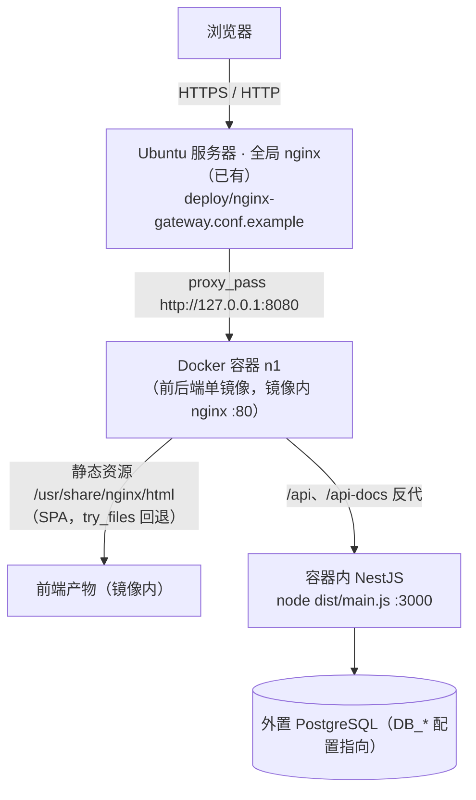
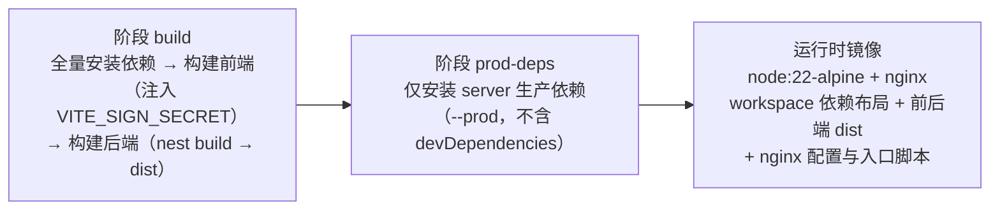

# Docker 打包与部署指南

n-1 提供两种可选部署方案：[发布包直部署](发布包打包与部署指南.md)与 **Docker 镜像部署**（本指南），两者平级、按目标环境选型（选型对比见[发布包打包与部署指南 §1](发布包打包与部署指南.md#1-方案选型)）。本指南是 docker 打包编译工具链与服务器部署的唯一设计依据：镜像结构、构建流程、流水线接入、服务器初始化与日常发布 / 回滚操作均以本文为准。

## 1. 部署形态与网络拓扑



要点：

- **两级 nginx**：服务器全局 nginx 只认一个 upstream（`127.0.0.1:8080`），不感知容器内部结构；镜像内 nginx 负责静态资源与 API 分流（对比发布包直部署方案多一层镜像内 nginx）。镜像自包含，可整体迁移。
- **入口脚本**：容器启动时 `entrypoint.sh` 依次执行——用 `pg` 探测数据库连通性（每 2 秒重试，超时上限 `DB_WAIT_TIMEOUT`，默认 120s）→ 执行迁移（ADR-005）→ 拉起 nginx → `exec node dist/main.js` 作为 PID 1（`docker stop` 的 SIGTERM 直达应用进程，触发 `enableShutdownHooks` 优雅关停）。迁移失败时容器启动即退出，由 `restart: unless-stopped` 自动重试，故障显性化。
- **端口仅本机监听**：compose 将容器 80 映射到 `127.0.0.1:8080`，外部无法绕过全局 nginx 直连容器。
- **数据库外置**：容器经 `DB_*` 环境变量连接外部 PostgreSQL；数据库与服务器同机时 `DB_HOST` 填 `host.docker.internal`（compose 已配置 host-gateway 映射）。
- **配置外置**：`deploy/server.env` 放服务器工作目录，经 compose `env_file` 注入容器——容器启动时读取宿主机文件，镜像内不含任何环境差异配置。
- **健康检查**：后端 `/api/health` 为 `@Public` 健康检查接口（`app.controller.ts`），compose 以 `wget http://127.0.0.1/api/health` 探活（经镜像内 nginx 转发到应用）。

## 2. 工具链文件清单

| 文件 | 职责 |
| --- | --- |
| `Dockerfile`（根） | 多阶段构建：依赖安装 → 前后端编译 → 生产依赖提取 → 运行时镜像组装 |
| `.dockerignore`（根） | 排除 `.git`、`node_modules`、`dist`、`server/.env` 等，瘦身构建上下文并防止配置泄入镜像 |
| `docker/nginx.conf` | 镜像内 nginx 站点配置：静态资源缓存、SPA 回退、`/api` 反代 |
| `docker/entrypoint.sh` | 容器入口：等数据库 → 跑迁移 → 起 nginx → exec node（PID 1，SIGTERM 优雅关停） |
| `deploy/docker-compose.yml` | 服务器运行编排：端口映射、env_file、健康检查、重启策略（放 `/opt/n1/`） |
| `deploy/server.env.example` | 外置运行配置模板（复制为 `server.env` 后修改，放 `/opt/n1/`） |
| `deploy/nginx-gateway.conf.example` | 服务器全局 nginx 站点配置示例（纯转发到容器 8080） |
| `deploy/deploy.sh` | 部署阶段执行脚本：`docker load` + `docker compose up -d` + 清理悬空层 |

## 3. 镜像设计

### 3.1 多阶段构建（Dockerfile）



- 基础镜像 `node:22-alpine`、pnpm 锁 `11.6.0`，与开发环境（node 22 + pnpm 11）对齐——pnpm 11 的 lockfile 须同代 pnpm 消费。
- pnpm workspace 的 `server/node_modules` 以符号链接指向根 `node_modules/.pnpm`，运行时镜像按 workspace 布局整体拷贝（`COPY --from=prod-deps /app /app`），工作目录 `/app/server`。
- 前端签名密钥经构建参数注入：`VITE_SIGN_SECRET` 未传时回退到与 `web/.env.production` 相同的占位值（Vite 规则：进程环境变量优先于 `.env` 文件）。
- apk 源换为阿里云镜像（`dl-cdn.alpinelinux.org` 国内网络可达性差）。

## 4. 服务器初始化（一次性）

以下命令在 Ubuntu 服务器上以 root / sudo 执行，文件内容取自仓库 `deploy/` 目录：

```bash
# 1. 安装 Docker（已装可跳过；官方源自带 docker compose 插件）
curl -fsSL https://get.docker.com | sh

# 2. 创建部署目录，放入编排与配置文件
mkdir -p /opt/n1
#   - deploy/docker-compose.yml      → /opt/n1/docker-compose.yml
#   - deploy/server.env.example      → /opt/n1/server.env（务必修改占位值）
vim /opt/n1/server.env

# 3. 全局 nginx 站点配置（按实际域名 / 证书补全后软链或拷入 conf.d）
#   deploy/nginx-gateway.conf.example → /etc/nginx/conf.d/n1.conf
nginx -t && nginx -s reload

# 4. 首次拉起（镜像由部署脚本加载后自动完成；也可先手动拉起验证链路）
docker compose -f /opt/n1/docker-compose.yml up -d
```

`server.env` 必改项见[发布包打包与部署指南 §8 配置参考](发布包打包与部署指南.md#8-配置参考serverenv)（两方案共用同一份配置，仅注入方式不同）；占位密钥未改时应用会启动失败（fail-fast 校验），属预期防护。

## 5. CI/CD 流水线接入

工具链不绑定具体平台（主流 CI/CD 均可接入），流水线按通用三段形态组织：


接入要点：

1. **触发**：代码 push 到 `main` 分支（或各平台等价机制）。
2. **加密变量**：`VITE_SIGN_SECRET`——值为前端签名密钥，**必须与 `server.env` 中 `SIGNATURE_SECRET` 完全一致**，不一致表现为登录后所有写请求被签名校验拒绝。
3. **构建**：构建环境需具备 docker CLI 与 daemon（托管构建环境无 daemon 时，改用自托管构建机或 kaniko 类无 daemon 构建工具），命令：

```bash
set -e

# 构建镜像：latest 供 compose 引用，编号 tag 供服务器侧回滚定位
docker build -t n1:latest -t "n1:${BUILD_NUMBER:-local}" \
  --build-arg VITE_SIGN_SECRET="$VITE_SIGN_SECRET" .

# 导出压缩 tar 作为构建产物（同时保留两个 tag）
docker save n1:latest "n1:${BUILD_NUMBER:-local}" | gzip > n1-image.tar.gz
```

4. **产物**：归档 `n1-image.tar.gz` 与 `deploy/` 目录（后者供首次初始化与部署脚本使用）。
5. **部署**：将产物送达服务器任意临时目录，以具备 docker 权限的账号执行 `sh deploy/deploy.sh`——校验 `/opt/n1/server.env` 与 `docker-compose.yml` 就位 → `docker load -i n1-image.tar.gz` → `docker compose up -d` → 清理悬空层（保留带 tag 的历史镜像供回滚）→ 输出容器状态。

## 6. 日常发布与回滚

- **发布**：push 到 `main` 即全链路自动执行；进度与日志在 CI 平台查看。
- **验证**：部署后访问全局 nginx 域名的 `/api/health` 应返回健康信息；服务器上 `docker ps` 应见 `n1` 容器 `(healthy)`。
- **回滚（快速）**：服务器上历史镜像以流水线编号为 tag 保留，执行：
  ```bash
  docker tag n1:<历史编号> n1:latest
  docker compose -f /opt/n1/docker-compose.yml up -d
  ```
- **回滚（重建）**：重发历史构建产物重新执行部署阶段（CI 产物库保留历史版本时），或 revert 提交后重新触发流水线，适合历史镜像已被清理的场景。

## 7. 常见问题

| 现象 | 排查 |
| --- | --- |
| 容器反复重启，日志含数据库等待超时 | `server.env` 的 `DB_*` 配置有误或数据库未放行容器访问；同机数据库确认 PostgreSQL 监听地址包含 docker 网桥（`listen_addresses` 与 `pg_hba.conf`） |
| 登录成功但所有写请求失败 | 前端 `VITE_SIGN_SECRET`（构建期注入）与后端 `SIGNATURE_SECRET`（运行期注入）不一致，两边对齐后重新构建 / 重启 |
| 页面白屏 / 静态资源 404 | 全局 nginx 与镜像内 nginx 均约定部署在域名根路径（`/`），子路径部署需调整 Vite `base` 与两份 nginx 配置 |
| 上传文件 413 | 两级 nginx 均已设 `client_max_body_size 20m`，超限自行上调（`deploy/nginx-gateway.conf.example` 与 `docker/nginx.conf` 同步改） |
| 发版后页面未更新 | 浏览器缓存了旧 `index.html`；镜像内 nginx 已对该文件设 `no-cache`，强制刷新一次即可 |
