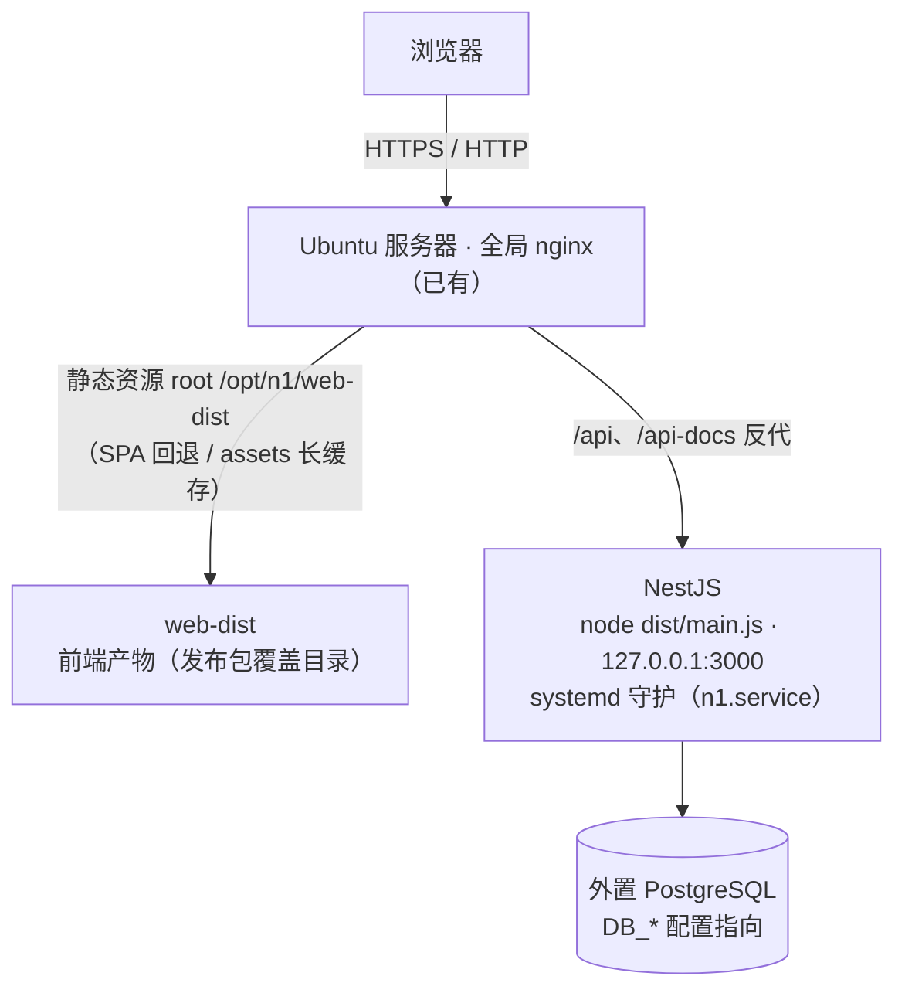
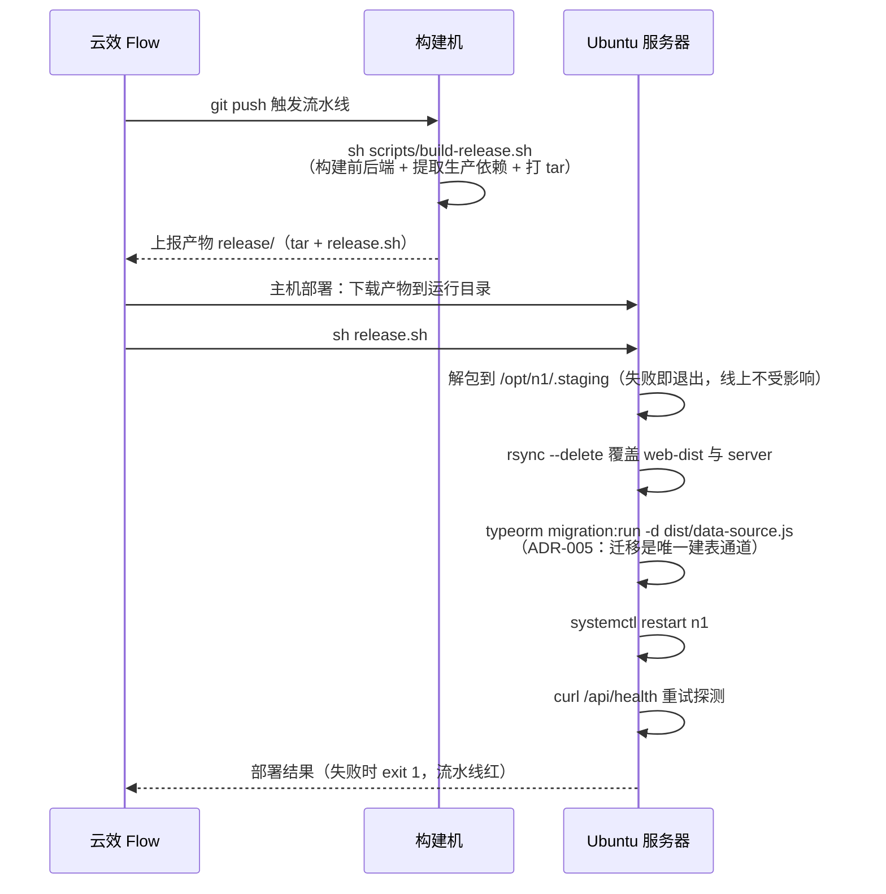

# 打包与部署指南

本文是 n-1 发布包直部署（**主方案**）的唯一设计依据：发布包结构、构建脚本、云效流水线配置、服务器初始化与日常发布 / 回滚操作均以本文为准。决策背景见 [ADR-007](../决策/ADR-007-发布包直部署.md)；docker 单镜像为备选方案，见 [Docker 打包与部署指南](Docker打包与部署指南.md)（何时选备选见本文 [§9](#9-备选方案docker-单镜像)）。

## 1. 部署形态与网络拓扑



要点：

- **单级 nginx**：全局 nginx 直接承担流量分流——静态资源 `root /opt/n1/web-dist`（SPA `try_files` 回退、`/assets/` 长缓存、`index.html` 不缓存），`/api`、`/api-docs` 反代到本机 NestJS。对比 docker 备选方案少一层镜像内 nginx。站点配置见 `deploy/nginx-site.conf.example`。
- **systemd 守护**：后端以 `n1.service` 常驻（`WorkingDirectory=/opt/n1/server`，`ExecStart=/usr/bin/node dist/main.js`），崩溃自动重启（`Restart=on-failure`）；运行配置经 `EnvironmentFile=/opt/n1/server.env` 注入——发布包内不含任何环境差异配置。
- **端口安全**：NestJS 监听 3000，仅本机回环访问（nginx 反代）；服务器安全组 / 防火墙不应对公网放开 3000。
- **数据库外置**：经 `DB_*` 环境变量连接外部 PostgreSQL，不随发布包交付。

## 2. 工具链文件清单

| 文件 | 职责 |
| --- | --- |
| `scripts/build-release.sh` | 构建发布包（CI 与本地通用，不依赖 docker）：构建前后端 → 提取生产依赖 → 打版本化 tar.gz |
| `deploy/release.sh` | 云效「主机部署」执行脚本：解包 → 覆盖 → 迁移 → 重启 → 健康探测（随构建产物一起上传） |
| `deploy/n1.service` | systemd 服务单元（安装到 `/etc/systemd/system/`） |
| `deploy/server.env.example` | 外置运行配置模板（复制为 `/opt/n1/server.env` 后修改） |
| `deploy/nginx-site.conf.example` | 全局 nginx 站点配置示例（静态托管 + API 反代） |

## 3. 发布包设计

### 3.1 构建流程（build-release.sh）

脚本在仓库根执行 `sh scripts/build-release.sh`，五步流水：

1. `pnpm install --frozen-lockfile` 安装全量依赖（CI 无 pnpm 时自动安装同代版本）
2. 构建前端：进程环境变量 `VITE_SIGN_SECRET` 存在时自动覆盖 `web/.env.production` 占位值（Vite 规则：环境变量优先于 `.env` 文件）
3. 构建后端：`nest build` 产出 `server/dist`
4. **提取生产依赖**：`pnpm --filter server deploy --prod --legacy` 在 `release/staging/server` 产出自包含目录（symlink 相对闭环，不依赖 workspace 根；不影响本地开发环境的依赖），随后清理开发态文件——**本地构建时 `server/.env`（含数据库口令）绝不能进发布包**，CI 侧 git 仓库本就无此文件，清理为幂等保险
5. 打包：`web/dist` 一并拷入，附 `release-info`（版本时间戳 / commit / 构建时间），压成版本化 tar.gz；`deploy/release.sh` 拷到 `release/` 随产物上传（产物自包含，服务器无需再取仓库文件）

### 3.2 发布包结构

```text
n1-release-<时间戳>.tar.gz
├── server/            # 后端：dist + package.json + node_modules（自包含生产依赖，纯 JS 无原生模块）
├── web-dist/          # 前端产物（Vite 构建，含 assets 指纹文件）
└── release-info       # version / commit / time（部署时打印，供核对）
```

### 3.3 部署流程（release.sh）



前置校验：`server.env` 与 `n1.service` 未就位时脚本直接失败并提示初始化步骤，不产生半成品状态。

## 4. 服务器初始化（一次性）

以下命令在 Ubuntu 服务器上以 root / sudo 执行，文件内容取自仓库 `deploy/` 目录：

```bash
# 1. 安装 node 22（与构建机大版本对齐；生产依赖为纯 JS，锁大版本即可）
curl -fsSL https://deb.nodesource.com/setup_22.x | sudo -E bash -
sudo apt-get install -y nodejs

# 2. rsync（release.sh 覆盖发布依赖；多数发行版自带，缺了补装）
sudo apt-get install -y rsync

# 3. 创建部署目录，放入运行配置
sudo mkdir -p /opt/n1
#   deploy/server.env.example → /opt/n1/server.env（务必修改占位值，见 §7）
sudo vim /opt/n1/server.env

# 4. 安装 systemd 服务（enable 开机自启；首次启动由部署脚本的 restart 拉起）
#   deploy/n1.service → /etc/systemd/system/n1.service
sudo systemctl daemon-reload && sudo systemctl enable n1

# 5. 全局 nginx 站点（改 server_name 为实际域名 / IP，HTTPS 按需补证书）
#   deploy/nginx-site.conf.example → /etc/nginx/conf.d/n1.conf
sudo nginx -t && sudo nginx -s reload
```

`server.env` 必改项见 [§7 配置参考](#7-配置参考serverenv)；占位密钥未改时应用启动失败（fail-fast 校验），属预期防护。

## 5. 云效流水线配置

流水线结构：**源码触发 → 构建（出发布包）→ 主机部署（下载产物 + 执行部署脚本）**。

### 5.1 创建流水线

1. 云效 Flow 新建空流水线，源选择代码仓库（Codeup / GitHub / Gitee 等），触发器开启**代码提交自动触发**（push 到 `main` 分支）。
2. 添加**变量**（流水线设置 → 变量和缓存）：`VITE_SIGN_SECRET`（服务变量，加密存储）——值为前端签名密钥，**必须与 `server.env` 中 `SIGNATURE_SECRET` 完全一致**，不一致表现为登录后所有写请求被签名校验拒绝。

### 5.2 构建阶段

添加「执行命令」步骤（运行环境选择 node 22；pnpm 脚本会自动兜底安装），命令一行：

```bash
sh scripts/build-release.sh
```

构建产物勾选上报：`release/` 目录（内含 tar 包与 `release.sh`，脚本执行完自动就位）。

### 5.3 主机部署阶段

1. 主机组中添加 Ubuntu 服务器（阿里云 ECS 可自动安装 Agent，其他机器按云效指引手动安装 Agent 或配置 SSH 授权）。
2. 制品选择上一阶段的构建产物（`release/` 目录），部署脚本执行：

```bash
sh release.sh
```

## 6. 日常发布与回滚

- **发布**：push 到 `main` 即全链路自动执行；进度与日志在云效流水线页查看。
- **验证**：部署后访问全局 nginx 域名的 `/api/health` 应返回健康信息；服务器上 `systemctl status n1` 应为 `active (running)`。
- **回滚**：云效流水线的历史运行中**重发历史构建产物**（主机部署阶段选择历史制品重新执行，约几分钟完成），或 revert 提交后重新触发流水线。服务器**不维护历史版本目录**——版本历史由云效产物承载（见 ADR-007 决策 4）。
- **日志**：`journalctl -u n1 -e` 查看后端运行日志，`journalctl -u n1 --since "10 min ago"` 看近期片段。

## 7. 配置参考（server.env）

| 变量 | 必改 | 说明 |
| --- | --- | --- |
| `NODE_ENV` | — | 固定 `production` |
| `PORT` | — | NestJS 端口，固定 `3000`（nginx 站点按此反代） |
| `DB_HOST` / `DB_PORT` / `DB_USERNAME` / `DB_PASSWORD` / `DB_DATABASE` | ✅ | 外置 PostgreSQL 连接信息；数据库与服务器同机填 `127.0.0.1`，独立数据库服务器填其内网 IP |
| `DB_SYNC` | — | 保持 `false`：生产强制关闭，建表与升级由部署脚本迁移执行（ADR-005） |
| `JWT_SECRET` | ✅ | 长随机串；沿用开发默认值会启动失败（fail-fast） |
| `USER_INIT_PASSWORD` | ✅ | 种子账号 admin 的初始口令 |
| `SIGNATURE_ENABLED` / `SIGNATURE_SECRET` | ✅ | 签名开关与密钥；开启时密钥须与前端构建注入的 `VITE_SIGN_SECRET` 一致 |
| `SIGNATURE_EXPIRE_MS` | — | 签名时间窗，默认 300000（5 分钟） |
| `SWAGGER_ENABLED` | — | 生产建议 `false`（关闭 `/api-docs`） |

修改 `/opt/n1/server.env` 后重启生效：`sudo systemctl restart n1`（systemd 重新读取 `EnvironmentFile`）。

## 8. 常见问题

| 现象 | 排查 |
| --- | --- |
| 服务起不来，`journalctl -u n1` 含数据库连接错误 | `server.env` 的 `DB_*` 配置有误或数据库未放行访问；同机数据库确认 PostgreSQL `listen_addresses` 与 `pg_hba.conf` 覆盖本机连接 |
| 登录成功但所有写请求失败 | 前端 `VITE_SIGN_SECRET`（构建期注入）与后端 `SIGNATURE_SECRET`（运行期注入）不一致，两边对齐后重新构建 / 重启 |
| 页面白屏 / 静态资源 404 | nginx 站点约定部署在域名根路径（`/`），子路径部署需调整 Vite `base` 与 nginx 站点配置 |
| 上传文件 413 | 站点已设 `client_max_body_size 20m`，超限自行上调（`deploy/nginx-site.conf.example`） |
| 发版后页面未更新 | 浏览器缓存了旧 `index.html`；站点已对该文件设 `no-cache`，强制刷新一次即可 |
| 部署脚本健康探测失败 | 看 `journalctl -u n1 -e`；常见为迁移失败（数据库不可达 / 迁移冲突）导致服务未就绪 |

## 9. 备选方案：docker 单镜像

当部署形态演进为多机分发、容器化平台（K8s 等）或需要环境强隔离时，切换到 docker 单镜像方案（镜像内 nginx 托管静态资源与 API 分流，`docker load` + `compose up` 发布），工具链资产与操作手册见 [Docker 打包与部署指南](Docker打包与部署指南.md)，决策对比见 [ADR-006](../决策/ADR-006-部署形态与镜像打包.md)（已被 [ADR-007](../决策/ADR-007-发布包直部署.md) 取代，降为备选）。
